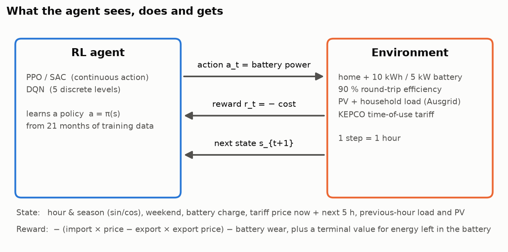
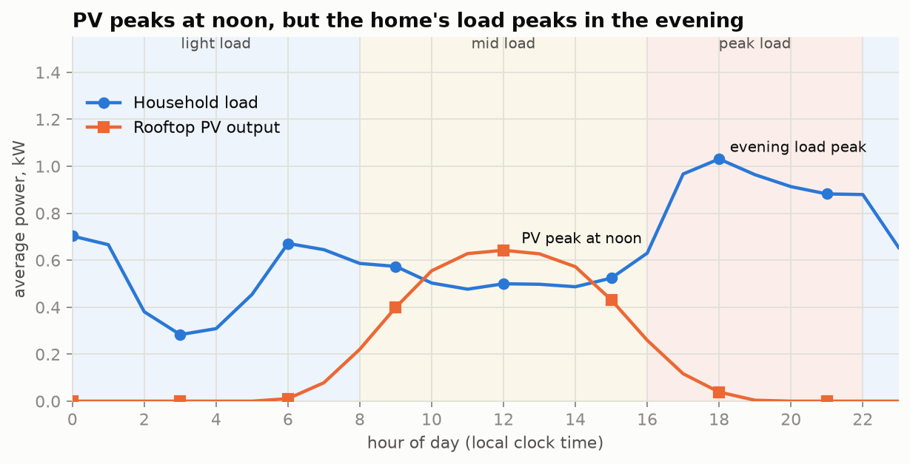
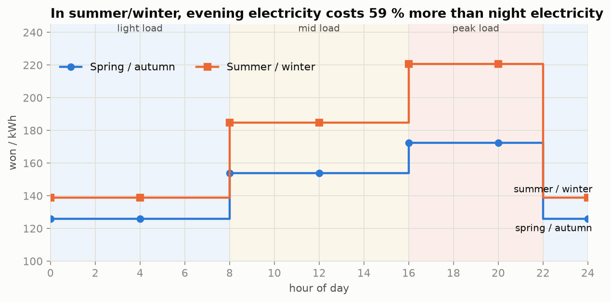

# Home Battery Energy Management with Reinforcement Learning


A household with rooftop solar panels and a battery pays a **time-of-use (TOU) electricity tariff**. Every hour an RL agent decides how much to charge or discharge the battery so that the yearly electricity bill is as low as possible.


*Three January days of one home. The grey area on top is the electricity price. Below, the battery charge chosen by three different strategies. The oracle (green) sees the whole future; the RL agents have to learn this behaviour from data.*

**Course project** — Reinforcement Learning · Student: Lilov Lechi (ID 120260317) · [github.com/lechi-lilov](https://github.com/lechi-lilov)

---

## At a glance

| | |
|---|---|
| **Problem** | Minimise a household's electricity cost with a battery under a TOU tariff and rooftop PV |
| **Data** | Real half-hourly load and PV of Australian homes (Ausgrid), real Korean TOU tariff (KEPCO) |
| **Environment** | Own Gymnasium environment `EnergyEnv`, 1 step = 1 hour |
| **Algorithms** | PPO and SAC (continuous power), DQN (5 discrete levels), via Stable-Baselines3 |
| **Reference points** | Do nothing · PV self-consumption · tuned TOU rule · LP oracle (perfect foresight) |
| **Evaluation** | One full unseen year, 10 homes seen in training + 4 homes never seen |

## Project status

| Step | State |
|---|---|
| Data selection, cleaning, hourly preprocessing | done |
| Environment `EnergyEnv` (+ 17 tests, `check_env` passes) | done |
| Baselines: do nothing, self-consumption, rule-based, LP oracle (+ 7 tests) | done |
| RL training: PPO, SAC, DQN | **not started yet** |
| Hyper-parameter study, 5 seeds with confidence intervals | planned |
| Learning curves, animated demo of the trained agent, final report | planned |

Everything below that is not marked *planned* was actually run, and the numbers come from `results/`.

## How it fits together


## Environment: state, action, reward



| | Design | Why |
|---|---|---|
| **State** (14 numbers) | hour and day-of-year as sin/cos, weekend flag, battery charge, tariff price now and for the next 5 hours, **previous hour's** load and PV | The tariff is a known schedule, so the price lookahead is legitimate. The current hour's load and PV are *not* given: a real controller does not know them before it decides |
| **State, optional** (+6) | load and PV of the same hours one day earlier ("persistence forecast") | Used for an ablation: does a simple forecast help? |
| **Action** | battery power in [-1, 1] × 5 kW (positive = charge). Impossible requests are clipped by the battery limits | Continuous for PPO/SAC; DQN uses 5 evenly spaced levels |
| **Reward** | −(grid import × price − export × export price) − wear cost, divided by 100 | Reward is exactly the quantity we want to minimise |
| **Episode** | 7 days (168 steps) in training, random home and start day; the whole test year in evaluation | |
| **Terminal value** | energy left in the battery at the episode end is valued at the average tariff price | Without it the agent learns to empty the battery just before the episode ends |

**Battery physics** (assumed typical values, all in [`configs/env.yaml`](configs/env.yaml)): 10 kWh, 5 kW, 95 % one-way efficiency (90 % round trip), usable charge 10 – 90 %.

## Data



* **Source:** Ausgrid *Solar Home Electricity Data*: 300 homes with rooftop PV, half-hourly, 1 July 2010 – 30 June 2013, licence CC BY 3.0 AU. Load = general consumption + controlled load; PV = gross generation. The two later files carry a row-quality flag and none of the selected homes has an estimated value; the first year has no flag column, but Ausgrid states that it contains complete actual meter data.
* **Selection (rule fixed before looking at results):** homes with complete data and a daily consumption between the 25th and 75th percentile → 147 candidates → 14 drawn at random (seed 42): **10 training homes** and **4 held-out homes** the agent never sees.
* **Time split:**

| Split | Period | Used for |
|---|---|---|
| Train | Jul 2010 – Mar 2012 (21 months) | learning |
| Validation | Apr – Jun 2012 | choosing hyper-parameters and tuning the rule baseline |
| Test | Jul 2012 – Jun 2013 (one full year, all seasons) | final numbers only |

* **Preprocessing:** two half-hours are summed to one hour (kWh per hour = mean kW). Each yearly CSV uses a different date format, which is parsed explicitly and fails loudly on any mismatch.
* **Where to get it:** Ausgrid removed the data from its website in 2026. We use the archive copy published by P. Haessig ([`scripts/download_data.py`](scripts/download_data.py)). The processed hourly file is committed, so the download is optional.

## Tariff



Residential TOU tariff of KEPCO (`주택용 계시별`, Jeju), from the tariff table effective **2023-05-16**. Energy charges only; the basic charge does not depend on battery use. It is the only residential TOU row we found in that table, so the price level is Korean while the load and PV data are Australian (see limitations).

## Baselines: how good can it get?


| Policy (test year) | Saving vs. no battery, 10 seen homes | Share of oracle saving | 4 unseen homes |
|---|---|---|---|
| Do nothing | 0 % | 0 % | 0 % |
| PV self-consumption | 17.0 % ± 4.4 | 63 % ± 9 | 12.4 % ± 15.1 |
| Rule-based (tuned on validation) | 14.7 % ± 2.5 | 56 % ± 5 | 12.6 % ± 9.5 |
| **LP oracle (perfect foresight)** | **26.2 % ± 3.9** | 100 % | 21.6 % ± 14.3 |

Mean ± 95 % confidence interval over homes. Only 4 homes are unseen, so those intervals are wide. Raw numbers: [`results/baselines_summary.csv`](results/baselines_summary.csv).

What this tells us:

* The battery is worth having: perfect foresight cuts the bill by about a quarter.
* **Storing PV surplus alone already captures 63 % of that.** The RL agents must beat self-consumption, not just "do nothing", to show they learned something useful.
* A simple charge-at-night rule, tuned on validation data, does not beat self-consumption (14.7 % vs. 17.0 %; the difference lies within the confidence intervals). A plausible reason, not tested here, is that the 10 % round-trip loss eats part of the night-to-evening price gap.
* The remaining ~37 % is the room for learning.

The four reference policies:

| Policy | Idea | Knows the future? |
|---|---|---|
| Do nothing | battery never used | – |
| Self-consumption | store PV surplus, cover deficits, never charge from the grid | reacts to the current hour |
| Rule-based | charge in the cheapest hours up to a target, discharge (limited to the home's load) in the dearest hours; 4 parameters tuned by grid search on validation | tariff schedule only |
| LP oracle | linear program over the whole year with the exact environment physics, a true lower bound on cost | everything |

The oracle's plan, replayed in the environment, reproduces the LP cost to within 0.01 % (tested), so the environment and the optimiser agree on the physics.

## RL experiments *(planned)*

| Question | Experiment |
|---|---|
| Which algorithm? | PPO vs. SAC vs. DQN |
| Which hyper-parameters? | learning rate and discount factor, 2 – 3 values each, chosen on the validation split |
| Is it reliable? | 5 random seeds per setting, mean ± 95 % CI |
| Does it generalise? | test year, and 4 homes never seen in training |
| What matters in the design? | ablations: with / without forecast features, reward in "cost" vs. "savings" form, battery wear cost on / off, export price |
| What did it learn? | day plots of price, charge and actions, learning curves, animated demo |

Results, trained models and the final report will be added here.

## Quick start

```bash
git clone https://github.com/lechi-lilov/rl-home-battery.git
cd rl-home-battery
python -m venv .venv
.venv\Scripts\activate            # Windows   (Linux/macOS: source .venv/bin/activate)
pip install -r requirements.txt

python -m pytest -q               # 24 tests: environment, tariff, baselines, LP vs. environment
python -m baselines.evaluate_baselines   # writes results/*.csv (a few minutes)
python -m scripts.make_figures    # rebuilds docs/img/*.png
```

Optional, to rebuild the processed data from the raw files:

```bash
python scripts/download_data.py   # about 57 MB
python scripts/01_preprocess.py   # writes data/processed/hourly.csv and configs/data.yaml
```

The code runs on CPU only. All random choices use fixed seeds.

## Repository layout

```
env/            EnergyEnv, tariff, data loading, evaluation helpers, DQN action wrapper
baselines/      do_nothing, self_consumption, rule_based, lp_optimal, evaluate_baselines
configs/        env.yaml (battery, reward), tariff_jeju.yaml, data.yaml (homes, splits)
scripts/        download_data, 01_preprocess, make_figures
tests/          test_env.py, test_baselines.py
data/processed/ hourly.csv (14 homes x 3 years)
results/        baseline tables and trajectories
docs/img/       figures used in this README
agents/ experiments/ models/ report/    planned: RL training, runs, saved models, slides
```

## Assumptions and limitations

* **Mixed geography.** Load and PV come from Australia (Sydney area); the tariff is Korean and applied by calendar month. Seasons are therefore reversed relative to the tariff's seasons. The tariff acts as a price signal, not as a claim about Korean households.
* **Not representative.** Ausgrid states that the 300 homes are not a statistically representative sample. They have PV and mostly live in houses.
* **Assumed battery.** 10 kWh / 5 kW / 90 % round trip are typical values, not measurements. They will be varied in sensitivity experiments.
* **No export revenue** is assumed (price 0), which favours storing PV. A non-zero export price is a planned sensitivity test.
* **Tariff vintage.** The tariff table dates from 2023 and covers Jeju only.
* **Clock time.** Source timestamps follow local daylight-saving time; tariff hours are clock hours, so the two stay consistent, but days with a clock change are slightly shifted.
* **Small unseen set.** Four held-out homes give wide confidence intervals.

## Credits

* **Load and PV data:** Ausgrid, *Solar Home Electricity Data* (CC BY 3.0 AU). Dataset paper: E. L. Ratnam, S. R. Weller, C. M. Kellett, A. T. Murray, "Residential load and rooftop PV generation: an Australian distribution network dataset", *International Journal of Sustainable Energy*, 2017 (reference as cited in P. Haessig's repository). Archive copy: P. Haessig, 2026.
* **Tariff:** KEPCO electricity tariff table, effective 2023-05-16.
* **Tools:** Gymnasium, Stable-Baselines3, PyTorch, SciPy (HiGHS linear programming), pandas, matplotlib.
