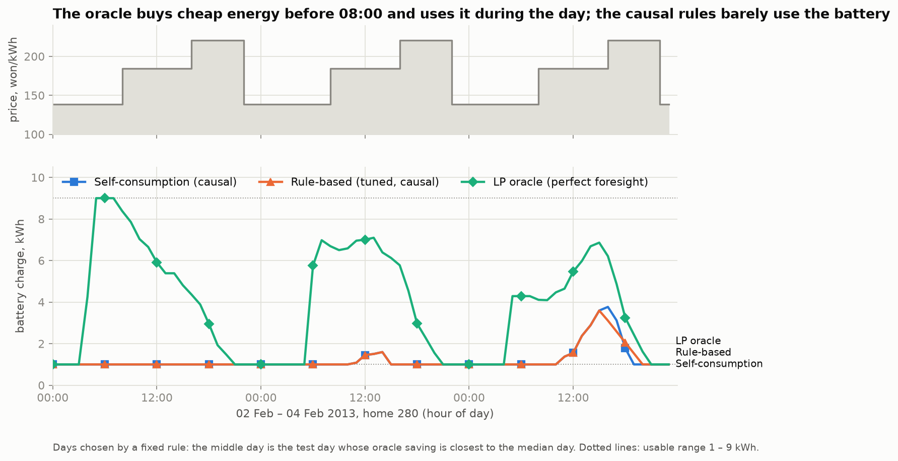
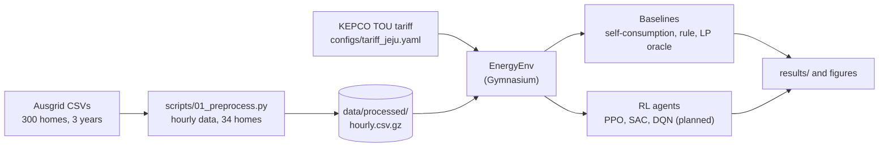
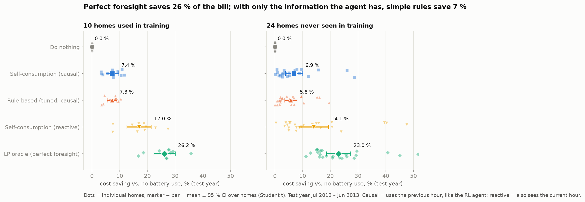

# Home Battery Energy Management with Reinforcement Learning


A household with rooftop solar panels and a battery pays a **time-of-use (TOU) electricity tariff**. Every hour an RL agent decides how much to charge or discharge the battery so that the yearly electricity bill is as low as possible.



*Three typical test days of one home (chosen by a fixed rule, not by hand). Top: electricity price. Bottom: battery charge. The oracle that knows the future (green) buys cheap energy before 08:00 and uses it during the day. Simple rules that only know the past barely use the battery. The RL agent has to close this gap.*

**Course project** — Reinforcement Learning · Student: Lilov Lechi (ID 120260317) · [github.com/lechi-lilov](https://github.com/lechi-lilov)

---

## At a glance

| | |
|---|---|
| **Problem** | Minimise a household's electricity cost with a battery under a TOU tariff and rooftop PV |
| **Data** | Real half-hourly load and PV of Australian homes (Ausgrid), real Korean TOU tariff (KEPCO) |
| **Environment** | Own Gymnasium environment `EnergyEnv`, 1 step = 1 hour |
| **Algorithms** | PPO and SAC (continuous power), DQN (5 discrete levels), via Stable-Baselines3 |
| **Reference points** | Do nothing · PV self-consumption (causal and reactive) · tuned TOU rule · LP oracle |
| **Evaluation** | One full unseen year; 10 homes used in training + 24 homes never seen |

## Project status

| Step | State |
|---|---|
| Data selection, cleaning, hourly preprocessing | done |
| Environment `EnergyEnv` (19 tests, `check_env` passes) | done |
| Baselines and LP oracle (9 tests) | done |
| Evaluation protocol fixed before any RL training | done (see below) |
| RL training: PPO, SAC, DQN | **not started yet** |
| Hyper-parameter study, 5 seeds with confidence intervals | planned |
| Learning curves, animated demo of the trained agent, final report | planned |

Everything below that is not marked *planned* was actually run, and the numbers come from `results/`.

## How it fits together



## Environment: state, action, reward


| | Design | Why |
|---|---|---|
| **State** (14 numbers) | hour and day-of-year as sin/cos, weekend flag, battery charge, tariff price now and for the next 5 hours, **previous hour's** load and PV | The tariff is a known schedule, so the price lookahead is legitimate. The current hour's load and PV are *not* given: the decision is taken at the start of the hour, before they are known (checked by a test) |
| **State, optional** (+6) | load and PV of the same hours one day earlier ("persistence forecast") | Used for an ablation: does a simple forecast help? |
| **Action** | battery power in [-1, 1] × 5 kW (positive = charge). Impossible requests are clipped by the battery limits | Continuous for PPO/SAC; DQN uses 5 evenly spaced levels |
| **Reward** | −(grid import × price − export × export price) − wear cost, divided by 100 | The reward is exactly the quantity we want to minimise |
| **Episode** | 7 days (168 steps) in training, random home and start day; evaluation: every validation week / the whole test year | |
| **Terminal value** | energy left in the battery at the episode end is valued at the average tariff price | Without it the agent learns to empty the battery just before the episode ends |

**Battery physics** (assumed typical values, all in [`configs/env.yaml`](configs/env.yaml)): 10 kWh, 5 kW, 95 % one-way efficiency (90 % round trip), usable charge 10 – 90 %.

## Data


* **Source:** Ausgrid *Solar Home Electricity Data*: 300 homes with rooftop PV, half-hourly, 1 July 2010 – 30 June 2013, licence CC BY 3.0 AU. Load = general consumption + controlled load; PV = gross generation. The two later files carry a row-quality flag and none of the selected homes has an estimated value; the first year has no flag column, but Ausgrid states that it contains complete actual meter data.
* **Selection (rule fixed before looking at any result):** homes with complete data and a daily consumption between the 25th and 75th percentile → 147 candidates. Seed 42 draws **10 training homes** and 4 held-out homes; seed 43 draws **20 more held-out homes** from the rest. The agent never sees the **24 held-out homes**.
* **Time split:** the test year comes after everything else. Validation is spread over the whole development period, so every season is represented when hyper-parameters are chosen.

| Split | Days | Used for |
|---|---|---|
| Train | Jul 2010 – Jun 2012, except days 8–14 of each month (563 days, ~18.5 months) | learning |
| Validation | days 8–14 of every month, Jul 2010 – Jun 2012 (24 weeks, all seasons) | choosing hyper-parameters, tuning the rule baseline |
| Test | Jul 2012 – Jun 2013 (one full year) | final numbers only |

* **Preprocessing:** two half-hours are summed to one hour (kWh per hour = mean kW). Each yearly CSV uses a different date format, which is parsed explicitly and fails loudly on any mismatch. Training episodes (7 days) always lie inside one block of training days and start at least 24 h after the block begins, so neither the episode nor the 24 h look-back of its observations ever touches a validation day (tested).
* **Where to get it:** Ausgrid removed the data from its website in 2026. We use the archive copy published by P. Haessig ([`scripts/download_data.py`](scripts/download_data.py)). The processed hourly file (5 MB, gzip) is committed, so the download is optional.

## Tariff


Residential TOU tariff of KEPCO (`주택용 계시별`, Jeju), from the tariff table effective **2023-05-16**. Energy charges only; the basic charge does not depend on battery use. It is the only residential TOU row we found in that table, so the price level is Korean while the load and PV data are Australian (see limitations).

## Baselines: how good can it get?



| Policy (test year) | Knows | Saving, 10 training homes | Share of oracle saving | Saving, 24 unseen homes |
|---|---|---|---|---|
| Do nothing | – | 0 % | 0 % | 0 % |
| Self-consumption, **causal** | past hours + tariff, **same as the RL agent** | 7.4 % ± 2.3 | 28 % ± 7 | 6.9 % ± 3.1 |
| Rule-based, tuned, **causal** | past hours + tariff, **same as the RL agent** | 7.3 % ± 1.8 | 27 % ± 5 | 5.8 % ± 2.2 |
| Self-consumption, reactive | **also the current hour** | 17.0 % ± 4.4 | 63 % ± 9 | 14.1 % ± 5.3 |
| **LP oracle** | **the whole future** | **26.2 % ± 3.9** | 100 % | 23.0 % ± 4.4 |

Mean ± 95 % confidence interval over homes (Student t). Raw numbers: [`results/baselines_summary.csv`](results/baselines_summary.csv).

What this tells us:

* The battery is worth having: perfect foresight cuts the bill by about a quarter.
* **Information is the bottleneck.** The same self-consumption idea saves 17 % when it sees the current hour and only 7 % when it has to act on the previous hour. The RL agent gets the past only, so the fair targets are the two *causal* baselines (~7 %). The reactive one is shown as a reference with an information advantage.
* The tuned rule ended up never charging from the grid (`soc_target = 0`, see [`results/rule_based_params.json`](results/rule_based_params.json)), i.e. it became causal self-consumption with a small evening discharge. On validation data, a fixed charge-at-night rule did not pay off.
* Yet the oracle *does* buy cheap night energy (figure at the top). Doing this well requires anticipating the next day's load and PV. That is exactly what an RL agent could learn from data, and the room between ~7 % and 26 % is what it can win.

The reference policies in detail:

| Policy | Idea |
|---|---|
| Do nothing | battery never used |
| Self-consumption (causal) | charge with the previous hour's PV surplus, discharge to cover the previous hour's deficit |
| Self-consumption (reactive) | the same, but with the current hour's values, like a hybrid inverter measuring in real time |
| Rule-based | charge in the cheapest tariff hours up to a target, discharge (at most the previous hour's load) in the most expensive hours, causal self-consumption in between; 4 parameters tuned by grid search on validation |
| LP oracle | linear program over each evaluation episode with the exact environment physics, a true lower bound on cost |

The oracle's plan, replayed in the environment, reproduces the LP cost to within 0.01 % (tested), so the environment and the optimiser agree on the physics.

## Evaluation protocol (fixed before any RL training)

1. **The test year is touched once.** Every choice (hyper-parameters, network size, reward variant, training length, which checkpoint to keep) is made on the validation weeks. The test year is run only for the final configurations. The baseline test numbers above were computed before RL training started; no RL design decision is based on them.
2. **Equal tuning budget.** Each algorithm gets the same number of hyper-parameter configurations and the same training-step budget, so no algorithm wins just because it was tuned more.
3. **Seeds.** Every final configuration is trained with 5 seeds. For each seed the metric is averaged over homes; the reported interval is the 95 % Student-t interval **over the 5 seeds** (training randomness). Baseline intervals are over homes (they have no training randomness); the two kinds of interval are never mixed in one comparison.
4. **"Better than a baseline"** is decided with a paired comparison on the same homes and test year: the per-home difference in saving, its mean and 95 % interval.
5. **Main metric:** saving vs. do nothing (%) on the test year; also share of the oracle saving, results on the 24 unseen homes, and learning curves on validation.

## RL experiments *(planned)*

| Question | Experiment |
|---|---|
| Which algorithm? | PPO vs. SAC vs. DQN |
| Which hyper-parameters? | learning rate and discount factor, 2 – 3 values each, chosen on validation |
| Is it reliable? | 5 random seeds per final setting, mean ± 95 % CI |
| Does it generalise? | test year, and 24 homes never seen in training |
| What matters in the design? | ablations: with / without forecast features, reward in "cost" vs. "savings" form, battery wear cost on / off, export price |
| What did it learn? | day plots of price, charge and actions, learning curves, animated demo |

Results, trained models and the final report will be added here.

## Quick start

```bash
git clone https://github.com/lechi-lilov/rl-home-battery.git
cd rl-home-battery
python -m venv .venv
.venv\Scripts\activate            # Windows   (Linux/macOS: source .venv/bin/activate)
pip install -r requirements.txt

python -m pytest -q               # 28 tests: environment, tariff, splits, baselines, LP vs. environment
python -m baselines.evaluate_baselines   # writes results/*.csv (about 4 minutes)
python -m scripts.make_figures    # rebuilds docs/img/*.png
```

Optional, to rebuild the processed data from the raw files:

```bash
python scripts/download_data.py   # about 57 MB
python scripts/01_preprocess.py   # writes data/processed/hourly.csv.gz and configs/data.yaml
```

The code runs on CPU only. All random choices use fixed seeds.

## Repository layout

```
env/            EnergyEnv, tariff, data loading and splits, evaluation helpers, DQN action wrapper
baselines/      do_nothing, self_consumption (causal + reactive), rule_based, lp_optimal, evaluate_baselines
configs/        env.yaml (battery, reward), tariff_jeju.yaml, data.yaml (homes, splits)
scripts/        download_data, 01_preprocess, make_figures
tests/          test_env.py, test_baselines.py
data/processed/ hourly.csv.gz (34 homes x 3 years)
results/        baseline tables and trajectories
docs/img/       figures used in this README
agents/ experiments/ models/ report/    planned: RL training, runs, saved models, slides
```

## Assumptions and limitations

* **Hourly decisions.** The agent fixes the battery power for a whole hour without knowing that hour's load and PV. A real hybrid inverter also reacts within the hour, which is why the reactive self-consumption baseline is much stronger. Our setting is the harder, information-limited version of the problem.
* **Mixed geography.** Load and PV come from Australia (Sydney area); the tariff is Korean and applied by calendar month. Seasons are therefore reversed relative to the tariff's seasons. The tariff acts as a price signal, not as a claim about Korean households.
* **Not representative.** Ausgrid states that the 300 homes are not a statistically representative sample. They have PV and mostly live in houses.
* **Assumed battery.** 10 kWh / 5 kW / 90 % round trip are typical values, not measurements. They will be varied in sensitivity experiments.
* **No export revenue** is assumed (price 0), which favours storing PV. A non-zero export price is a planned sensitivity test.
* **Tariff vintage.** The tariff table dates from 2023 and covers Jeju only.
* **Clock time.** Source timestamps follow local daylight-saving time; tariff hours are clock hours, so the two stay consistent, but days with a clock change are slightly shifted.
* **Validation weeks sit between training days.** Neighbouring days are correlated, so validation is slightly optimistic compared with a fully separate period; the final judgement is made on the test year, which is fully separate.

## Credits

* **Load and PV data:** Ausgrid, *Solar Home Electricity Data* (CC BY 3.0 AU). Dataset paper: E. L. Ratnam, S. R. Weller, C. M. Kellett, A. T. Murray, "Residential load and rooftop PV generation: an Australian distribution network dataset", *International Journal of Sustainable Energy*, 2017 (reference as cited in P. Haessig's repository). Archive copy: P. Haessig, 2026.
* **Tariff:** KEPCO electricity tariff table, effective 2023-05-16.
* **Tools:** Gymnasium, Stable-Baselines3, PyTorch, SciPy (HiGHS linear programming), pandas, matplotlib.
